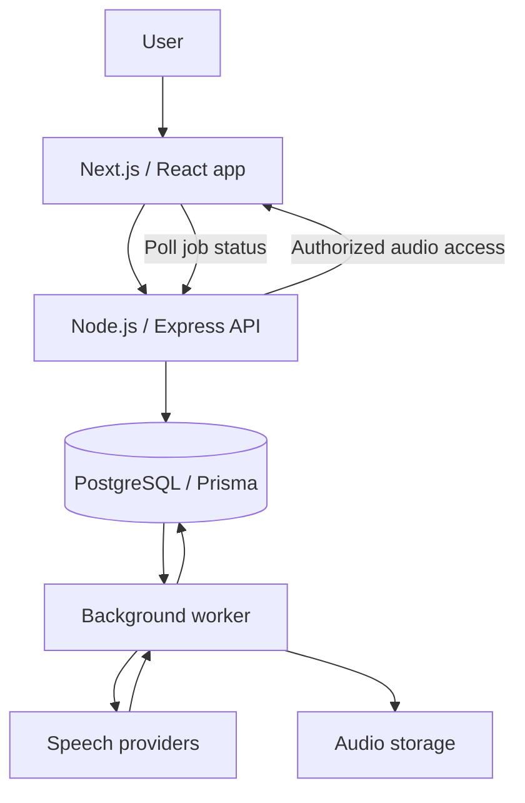

# AudioZem · Engineering Showcase

**Turn text, PDFs, and images into audio you can listen to while doing other things.**

[Try AudioZem](https://audiozem.com) · [Code sample](./chunk-text.ts) · [Tests](./chunk-text.test.ts) · [Run the demo](./demo.ts)

Built by **Dinesh Naga Teja Surepalli (Teja)**, founder and developer of AudioZem.

## The product

AudioZem helps people listen to documents and create spoken content. Users submit text or upload a document, choose a voice, and return to their library to play or download generated audio.

My work spans the Next.js/React frontend, TypeScript/Node.js APIs, authentication, background processing, provider integrations, deployment, and investigating issues reported by beta users.

## Start with the code

This repository contains a **new, standalone educational example inspired by AudioZem's long-document workflow**, prepared with AI assistance. It is not a verbatim extraction of the production implementation. The product overview describes AudioZem; the executable files demonstrate only the text-preparation step below.

Long text can exceed a speech provider's request limit. The example splits plain text into smaller requests while preserving the original content and order.

```ts
import { chunkText } from './chunk-text.ts';

const source = 'Hello world. Next sentence is longer.';
const chunks = chunkText(source, 20);

console.log(chunks[0].text); // 'Hello world. '
console.log(chunks.every(chunk => chunk.bytes <= 20)); // true
console.log(chunks.map(chunk => chunk.text).join('') === source); // true
```

### Run locally

Requires **Node.js 24 or newer**, which runs the TypeScript files directly. No dependencies, installation, credentials, or database are required.

```bash
git clone https://github.com/dineshnagateja/audiozem-engineering-showcase.git
cd audiozem-engineering-showcase
npm run demo
npm test
```

The demo prints chunk positions, byte sizes, and content, followed by `Exact reconstruction: true`. It does not call a speech provider or generate audio.

| File | What to review |
| --- | --- |
| [chunk-text.ts](./chunk-text.ts) | Typed chunk metadata, byte budgets, boundary selection, lossless text handling |
| [chunk-text.test.ts](./chunk-text.test.ts) | Eight tests including multilingual text and 200 deterministic mixed-input cases |
| [demo.ts](./demo.ts) | Offline walkthrough with English, Telugu, and emoji |

### Design decisions and limits

- **Count UTF-8 bytes.** Character count alone can underestimate multilingual input size. The caller must choose a limit matching their provider; token limits and request-envelope overhead need separate handling.
- **Preserve every character.** Chunks retain whitespace and include ordered UTF-16 start/end offsets. Joining chunk text exactly reconstructs the input.
- **Prefer readable boundaries.** Search the latter half of each candidate chunk for paragraph breaks, then sentence punctuation, then whitespace. Fall back to a code-point boundary for long unbroken input.
- **Keep the example small.** It operates in memory on plain text. It does not extract PDFs, synthesize speech, retry jobs, or merge encoded audio. The punctuation heuristic is not a full language-aware sentence segmenter.
- **Respect Unicode code points.** Valid surrogate pairs remain intact. Combining marks and multi-code-point emoji can span chunks; preserving grapheme clusters would require another segmentation policy.

## AudioZem architecture

The production product separates the web request from speech generation so a long-running job can be processed by a background worker.



| Layer | AudioZem technology / responsibility |
| --- | --- |
| Web app | TypeScript, React, Next.js; document input, job status, audio library |
| API | Node.js, Express, TypeScript; validation and account access |
| Persistence | PostgreSQL with Prisma; jobs and audio metadata |
| Processing | Background worker; provider calls, retries, stale-job recovery |
| Speech and extraction | Google Cloud Text-to-Speech, Gemini TTS, document/image text extraction |
| Deployment | Vercel frontend and Render backend/worker |

The diagram describes the product at a high level. This public sample does not implement that entire system.

## Problems I worked through

**Large documents:** A whole document cannot always fit into one speech request. Splitting it into ordered parts introduces new responsibilities: preserving text, tracking progress, handling partial failure, and assembling usable output. The sample isolates the first of those concerns so it is easy to run and review.

**Unusable audio:** Beta feedback surfaced generated audio that could not be played. I investigated and fixed the issue, returned credits for unusable results, and added monitoring and email alerts to catch problems earlier.

**Owning the full flow:** Building the product required connecting account access, user input, asynchronous generation, library playback, and deployment, then supporting the result after users tried it.

## Scope

This is a focused public engineering showcase. Production credentials, customer documents, infrastructure configuration, and the full application are not included. No production database or provider access is needed to review the example.

**Product:** [audiozem.com](https://audiozem.com) · **Developer:** [github.com/dineshnagateja](https://github.com/dineshnagateja)
